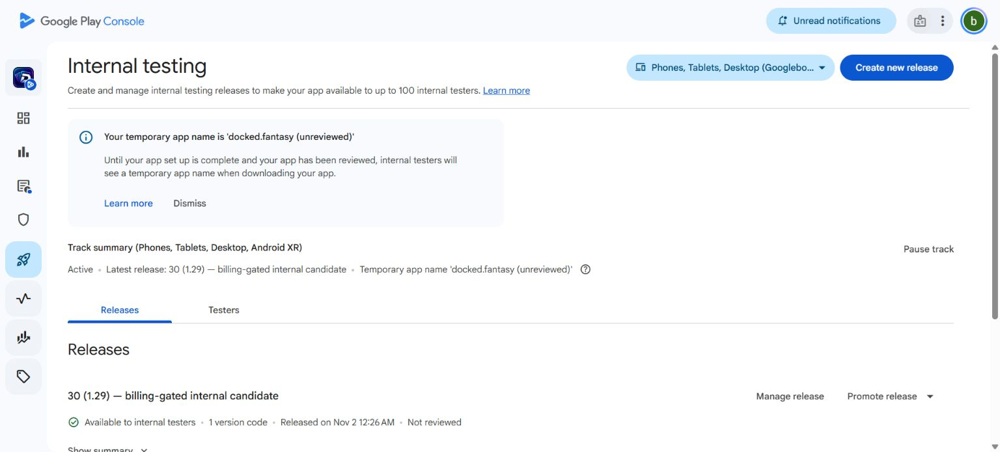
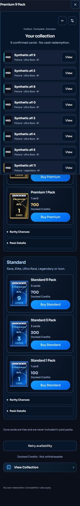
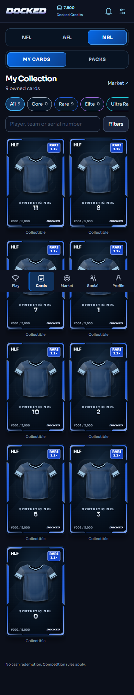
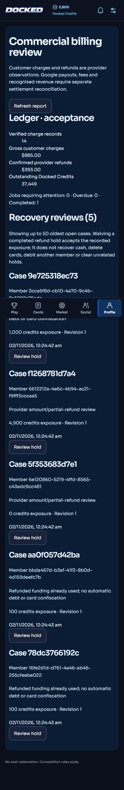

# Commercial Google Play release handover — 2 November 2026

**Internal testing: GO. Public paid launch: NO-GO.** Commercial billing is implemented, tested in isolation and staged with its switches off. Android **v30 / 1.29** is available to internal testers. No commercial migration, real payment, public registration, withdrawal, prize award or public release was activated.

This report supersedes the commercial-engineering gap in `FINAL_GOOGLE_RELEASE_READINESS_20261101.md`, but does not turn that report's genuine Google TEST results into commercial settlement evidence. It also identifies the remaining public-gameplay integration gap explicitly; a registration switch alone is insufficient.

## Commits, environments and Android

- `298e10259f8b45cb7b4420c40a8fc6544e6245a0`: gated commercial verifier, ledger, reconciliation, shared member experience, owner review, dormant gameplay inventory adapter, tests, policy drafts and Android v30 capability.
- `1b33983ed5a486e1f0ef8054c1620f076257199c`: delayed purchase completion after account closure goes to support review without issuing inaccessible credits; refunds still reconcile.
- Both pushed to `codex/member-platform-updates` in the existing repository. Evidence/report changes are committed separately.
- Staged candidate: https://docked-production-3omjjcfvs-briant-s-projects.vercel.app ; deployment `dpl_FtXztq1VYsdtZF8PRu8i74uUt6Fp`. The live custom domain was not promoted.
- **Live docked.com.au remains `053848ed67946fdd727a5c1d8547272d383c9470`**, deployment `dpl_2bWUkY1sgtshkifqRRty89oPfuzQ`. No customer records were mutated for this task's acceptance tests.
- Signed AAB: `artifacts/android/Docked-commercial-candidate.aab`, 9,214,095 bytes; SHA-256 `d3837d7191e0a6bbd64a572a9ac3288fd37b440eb36e67408648fb4b3c879e29`.
- Package `docked.fantasy`, versionCode **30**, versionName **1.29**, min SDK 24, target SDK 36. Existing upload key and Google Play App Signing retained. Console visibly confirmed **Available to internal testers**. Google generated the signed split/universal artifacts.
- v29 remains compatible with the live payment-disabled backend. v30 was necessary because v29's native implementation deliberately exposed only a TEST allowlist. v30 separates commercial capability from TEST configuration; it cannot enable server fulfilment or activate a Google product.
- Two non-blocking Console warnings remain: no deobfuscation mapping (release minification is disabled) and missing symbols in prebuilt native dependencies. The disconnected Samsung was not used: **no new physical v30 acceptance is claimed**.

## Commercial engineering and customer flow

The authenticated Docked identity is bound to Google using a server HMAC. The server verifies purchase tokens against Google's purchase and order APIs, checks the package, exact approved product, Australian region, purchase option, quantity, account binding, amount and environment, and rejects TEST receipts in commercial runtime. A browser cannot choose the customer, price, credited amount or receipt environment.

The approved products remain A$49 for 4,900 credits and A$99 for 9,900 credits, without bonuses. **Both Google options were read back as INACTIVE after the v30 release.** Commercial service, UI and checkout gates remain false. Permanent catalogue definitions are empty and unapproved until rights and lifetime-supply reconciliation are documented.

The monetary/credit journal, funding lots, pack opening and ownership provenance are private and separate from existing beta accounting, while using the same authenticated member identity and shared wallet presentation. There is no conversion or consolidation of existing test balances. Purchases and pack openings are idempotent; receipts cannot be replayed into another account. Atomic per-definition issuance preserves unique serials and an audited legacy supply baseline. Existing pack sizes/prices/odds are reused, with no Core in paid packs and no substituted exhaustion policy.

The shared pack shop, confirmation, reveal, collection and Profile summary are wired to the dormant commercial backend. Mobile and desktop fixture journeys covered Standard 9 in NFL/AFL/NRL and Premium 9 in AFL. Each confirmed purchase charged the configured credits once, opened nine cards once and updated the correct collection. Buy another pack requests a fresh confirmation. Draft commercial inventory can enter the existing AFL/NRL engine only through explicit new-round opt-ins; old rounds and snapshots are untouched.

Refund notifications authenticate Google's identity and exact audience/subscription, persist a deduplicated job, and re-fetch Google state. Jobs have leases, bounded retries, operator attention states and six-hour reconciliation of known receipts. Unknown notifications cannot create a credited identity. Fulfilment commits with durable consumption work; outages do not depend on an in-memory timer.

Full refunds remove the unused portion of the original purchased funding. Spent amounts produce an auditable recovery hold, never a negative spendable balance, automatic monetary debt, deleted opening or confiscation of another member's card. Partial/ambiguous amounts and delayed approval after account closure require support review. An independently authorised owner with MFA can waive an eligible completed-refund hold using a reason and expected revision. This does not send money or fabricate credits. Gross/refund totals and outstanding exposure are reported; provider fees, payouts and recognised revenue remain explicitly unreconciled.

## Verification actually completed

| Check | Actual result and boundary |
|---|---|
| Full platform suite | **709 passed**, 0 failed/skipped; includes NFL/AFL/NRL, NBA-hidden/scoring and authentication/regression guards. |
| Full database suite | **230 passed**, 0 failed/skipped; existing migration and gameplay regression coverage. |
| Commercial real PostgreSQL | **15 scenario groups passed** on disposable loopback PostgreSQL 17.10: pending/cancelled/delayed, 20 concurrent receipt retries, concurrent 9,900 purchases/openings, refund before/after spending/opening/transfer, partial-to-full replacement, out-of-order/outage/restart, closed-account approval, restricted role, RLS, supply and balanced accounting. |
| Existing gameplay engine | Real PostgreSQL AFL 22 / NRL 13: free Core plus owned Rare, draft/entry, saved multiplier, wrong member/round denied, listed/reserved transfer denied, withdrawal/transfer and current-owner Profile summary. Auth transport is an isolated fixture, **not public Auth acceptance**. |
| Rendered shared UI | 390 and 1440 px collections, three Standard 9 journeys, AFL Premium 9, reveal-all/completion actions and owner review layout. Zero recorded page errors/overflow in those checks. Synthetic fixtures and loopback service; **not hosted customer purchases**. |
| Typecheck/lint/build | Full TypeScript, ESLint and production build passed. The final account-closure patch was rechecked with TypeScript, targeted ESLint and all 15 real-PostgreSQL groups; the final staged Next build verifies that exact commit. |
| Android | Signed bundle/APK/native lint build passed, 415 tasks; internal Console upload/release confirmed. |
| Secrets | Staged-source heuristic passed; 94 built browser assets contained none of five server-secret canaries. The broad existing heuristic still flags eight old fixture/local-URL files and is **not** reported as a clean repository-wide scan. |
| Provider readback | Five existing genuine Google TEST orders parsed with the new verifier; commercial mode rejected all five. Read-only, no new purchase/refund or Google mutation. |
| Hosted candidate | Release identity, NBA-hidden/unauthenticated guards and closed commercial/member/owner endpoints checked separately in the candidate evidence. These do not constitute signed-in hosted commercial acceptance. |

The prior genuine ordinary-member 4,900/9,900 Google TEST checkout, wallet, nine-card pack, refund, authenticated Google notification and durable reconciliation results remain in `FINAL_GOOGLE_RELEASE_READINESS_20261101.md`. They were not repeated or mislabelled as real-money tests. No real commercial settlement occurred. No fresh Android startup-time claim is made without a device measurement.

## Public onboarding and reviewer access

The normal registration/email-confirmation/session/age-consent/recovery and abuse controls remain intact. Current regression coverage passed. Prior genuine reviewer free-Core selection, save, entry, Rankings and View Team passed for NFL/AFL/NRL. Prior isolated real-Supabase-Auth account deletion passed through the customer route, revoked sessions, denied repeat login and preserved minimal pseudonymous audit records. Those successful journeys were not repeated without a relevant change.

Reviewer identity remains `briantginty21@gmail.com`, with the owner-entered password held in Console, not Git or this report. Its practice programme expires **2027-01-31 00:00 UTC**. Updated instructions are in `GOOGLE_REVIEWER_ACCESS_20261101.md`.

**Outstanding engineering/configuration boundary:** the deployed AFL/NRL member routes and their SQL scope still require private-beta admission/context. The new commercial owned-card adapter reuses that existing engine; it does not create a public access programme. A separately approved public programme, region/consent policy and free/no-prize competition scope must be connected to an ordinary-member route and tested under real public-mode Auth before launch. Do not claim that enabling registration or commercial UI alone completes that integration. The current tests deliberately disclose their fixture identity adapter. Keep public registration and commerce off until this is resolved.

Public deletion also requires the approved commercial retention/identity policy and release-specific hosted validation. The existing beta deletion path intentionally sends shared identity cases for operator review. No genuine account was deleted here.

## Google Console and policy readiness

The existing saved App access, target audience (18+), Data Safety, privacy/deletion URLs, financial features and other content declarations remain the previously verified invitation-only configuration. Australia remains the prepared public country target. The listing contains NFL/AFL/NRL and existing assets; NBA stays hidden. Internal v30 release was the only new release publication. **No public review submission, new legal attestation or commercial declaration approval was made.**

Public paid wording and declarations must describe the actual enabled scope, purchase records, random packs and retention. They cannot be truthfully finalised as activated behaviour while commercial rights/policies and public access remain unresolved. Do not overwrite saved beta consents or treat Console's completed task list as Google's substantive approval.

The source-backed assessment is `COMMERCIAL_POLICY_REVIEW_20261101.md`. Final proposed privacy, refund, retention, commercial, digital-purchase, marketplace and competition texts are in `policies/2026-11-01-commercial-review/`. They remain **unpublished drafts for owner/adviser approval**. No statutory retention period, player licence, legal opinion or guaranteed compliance was invented.

Recommended scope for assessment: Australian adults, NFL/AFL/NRL, free Core participation, optional Google-paid packs, no cash redemption, no paid entry/prizes, and commercial card transfers disabled initially. The secondary market and rarity advantages require assessment together with paid packs; turning off cash-out alone is not a legal conclusion. Existing private-beta marketplace records remain intact.

## Migration approval and operations

Two exact, locally reapplied migrations are prepared, **neither applied to Production**:

1. `20261101120754_commercial_google_ledger.sql` — empty private commercial ledger/inventory/reconciliation structures and restricted NOLOGIN role; gates false/products unapproved.
2. `20261102010000_commercial_lineup_inventory.sql` — disabled opt-in inventory bridge, reservation protection and private Profile counts; no historical snapshot changes or programme activation.

Read-only Production check at **2026-11-01 13:45:18 UTC**: commercial schema absent; both migration IDs absent. No customer, wallet, permanent inventory, entry or balance was written by the commercial acceptance tests.

The complete preflight, grants, encryption keys, provider credentials, exact notification/worker configuration, backup/restore and rollback procedure is in `COMMERCIAL_MIGRATION_APPROVAL_20261102.md`. A fresh approved Production backup/restore drill is a prerequisite, **not a completed claim**. Rollback stops new checkout/issuance/transfers and returns the application alias; it must retain purchase, refund, ownership and retry records after the first commercial transaction. Never reset a wallet snapshot or drop the ledger to undo a release.

## Remaining decisions and work in order

1. **Owner/adviser:** approve the linked paid-pack/fantasy/transfer model, Australian classification/Google eligibility, real player/card/data rights and lifetime-supply baseline. Approve or reject the proposed closed-loop launch scope.
2. **Owner/adviser:** approve policy/consent versions, retention periods and bases, support/appeal/waiver process, provider locations and settlement reporting. No live retention cleanup should run before those decisions.
3. **Owner:** approve the two exact Production migrations and scoped runtime provisioning after the restore drill. No blanket pending-migration push. Scheduler/notification/credential access is provisioned only within that reviewed plan.
4. **Engineering after the public programme is fixed:** complete the ordinary-member gameplay access integration, bind approved free/no-prize rounds and verified roster eligibility, and execute hosted public registration/confirmation/gameplay/deletion plus commercial receipt/pack/refund/recovery acceptance. Reviewer beta access is not evidence of this public path.
5. **Release acceptance:** test Play-installed v30 on an available suitable device/Play environment; preserve the earlier successful v29 and TEST evidence. Phone reconnection was not requested while unavailable.
6. **Owner final approval:** approve accurate public Console declarations/attestations, store text, exact release/backend and separate product/registration activation. Only then submit publicly. Withdrawals, prizes, paid entry and NBA are outside this approval package.

Commercial coupons, social ownership attachments and the full commercial marketplace UI are not activated by this implementation. Keep those features unavailable for commercial inventory until their scope/adapters are separately reviewed; existing beta features are preserved. Financial settlement imports and the approved archival/minimisation implementation remain launch operations work, not capabilities inferred from a balanced test ledger.

## Evidence

- `qa/commercial-billing-20261101/verification-summary.json`
- `qa/commercial-billing-20261101/postgres.json`, `browser.json`, `provider-readback.json`
- `qa/commercial-billing-20261101/google-v30-readiness.json`
- `qa/commercial-billing-20261101/candidate/` — exact candidate, live rollback baseline and hosted guards. `commerce-apply.json` is a copied **prior beta fixture configuration receipt**, not evidence that a new commercial migration ran.

