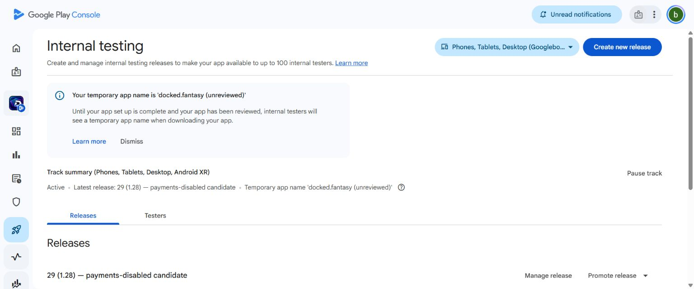
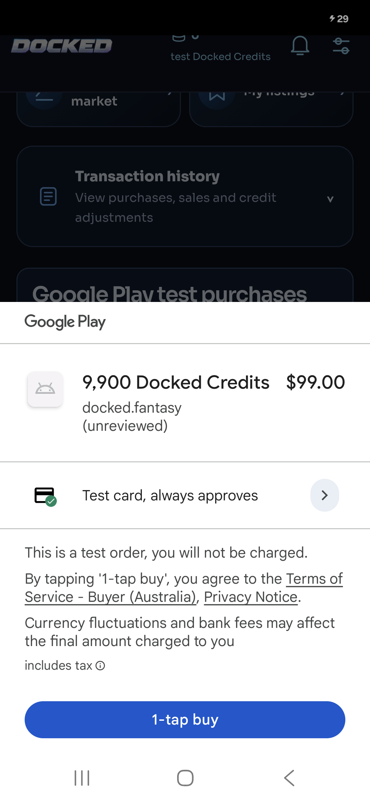
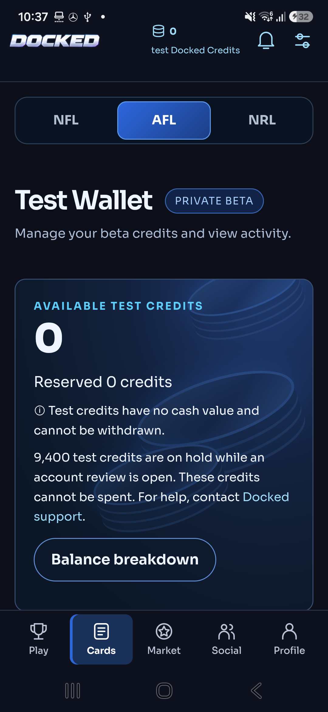
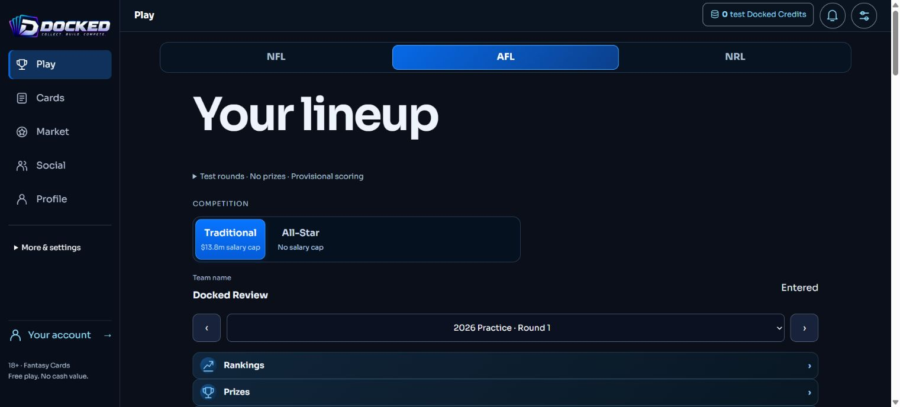
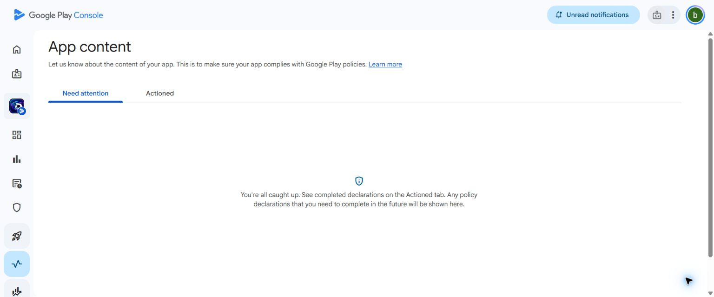

# Final Google Play release readiness — 1 November 2026

**The remaining 9,900-credit Google TEST journey, reviewer free-Core gameplay and isolated real-Auth deletion acceptance passed. Android v29 / 1.28 is released to internal testing and installed from Google Play on the Samsung. Public paid launch remains NO-GO pending commercial decisions, a separately reviewed real-money implementation and final owner approval.**

This supersedes the pending reviewer/deletion/9,900/Console/v29 status in `FINAL_GOOGLE_MEMBER_ACCEPTANCE_20261101.md`. Earlier successful 4,900-credit tests were preserved and not repeated unnecessarily. All timestamps below are UTC.

## Implemented, deployed and activated

| Item | Status and exact scope |
| --- | --- |
| Application | Live at https://docked.com.au, commit `053848ed67946fdd727a5c1d8547272d383c9470`; preceding fix `0ff3b5618db3d09482d9839e4b5fb18a3259a264`. |
| Backend | Vercel deployment `dpl_2bWUkY1sgtshkifqRRty89oPfuzQ`, `docked-production-hdijyy3uu-briant-s-projects.vercel.app`; Production Supabase `pojoymtniryarxxunyvz`. |
| Android | Existing signed v29 / 1.28 released to **internal only** at 11:31; Google Play-installed on Samsung SM-S921B at 11:34. No new build was needed. |
| Purchase test | Real Google no-charge TEST purchase against the ordinary, isolated QA member, using store-installed v28 / 1.27-member-test. No claim that the payment-disabled v29 made this purchase. |
| Free-Core review | Six explicitly authorised, editable no-prize practice competitions configured. Actual reviewer entered Traditional NFL/AFL/NRL through the hosted UI. |
| Deletion | Actual customer route + real local Supabase Auth + restricted runtime role passed in disposable Docker infrastructure. Not cloud Production erasure. |
| Console | All App content tasks saved; Console displayed “You're all caught up”. Draft changes still need Publishing overview review/submission. No public submission made. |
| Protections | NBA hidden, registration closed, real-money checkout/withdrawals/prizes disabled. Both Google purchase options INACTIVE, zero enabled Google TEST admissions, temporary QA access restored disabled. |

No schema migration was added or applied in this continuation. Previously approved migrations remain: `20261031123611_free_core_gameplay_eligibility.sql`, `20261031123931_member_google_test_receipts.sql`, `20261031234304_google_test_reconciliation_queue.sql`, and `20261101090955_free_core_verified_roster_adapter.sql`. The practice setup uses those existing structures with versioned configuration and a verified encrypted backup.

## Reviewer gameplay and fixes

The nominated reviewer signed in normally in Chrome. It has no owner role, no authentication exemption and no credit grant. The owner entered its password directly in Console; no password or bearer token is in source control, screenshots selected for this report, or this document.

| Sport | Verified Core eligibility | Actual selected lineup | Traditional salary |
| --- | ---: | ---: | --- |
| NFL | 386 | 7 | $3,500,000 / $4,400,000 |
| AFL | 545 | 22 | $11,000,000 / $13,800,000 |
| NRL | 337 | 13 | $6,500,000 / $8,200,000 |

For each sport the real reviewer UI completed **select players → save draft → confirm entry → Rankings → View Team** in **2026 Practice**. Team name **Docked Review** was set once using the normal member flow. All-Star rounds were configured but not separately entered. No score or prize was invented; Rankings correctly awaits statistics. No collectible cards were issued for Core eligibility.

Root causes resolved:

- PostgreSQL-derived Core identifiers were valid GUIDs but did not meet the request schema's stricter UUID-version bits. The boundary now accepts the stored GUID representation while the existing authoritative eligibility and ownership checks remain.
- AFL/NRL first-time users lacked the NFL team-name setup required to establish the fantasy-member relation. A shared `TeamNameSetup` component reuses the existing `name_team` action before save/entry. It does not write a fake member or bypass the permanent-name rule.
- Changing mode could select an unrelated historical round. It now retains compatible sport/season/round context.

`reviewer-hosted-readback.json` verifies seven/22/13 stored draft and entry selections. Historical rule snapshots and protected tables matched the pre-setup encrypted backup at 11:15, before the separate QA purchase. The only excluded changes in that comparison were the explicitly authorised reviewer entries/drafts. Exact six competition IDs and configuration receipts are in `reviewer-practice-apply-authorised-practice.json`; reviewer instructions are in `GOOGLE_REVIEWER_ACCESS_20261101.md`.

The existing beta programme ends **2027-01-31 00:00 UTC**. Continued review/public availability needs an approved supported access programme. Public onboarding is still disabled.

## Genuine ordinary-member 9,900-credit acceptance

Existing synthetic ordinary QA member ending `…96db7`; prior balance **4,500 held / 0 spendable**, **70 beta cards**. Those earlier test records were retained, not reset. No owner/reviewer/other-customer balance funded this journey.

| Event | Observed result |
| --- | --- |
| Google checkout | A$99 / 9,900 credits; native UI explicitly showed **Test card, always approves** and **you will not be charged**. No real card used. |
| Receipt 11:25:29 | Server-verified account-bound receipt; wallet total 14,400, previous hold 4,500, spendable **9,900**. One deposit/capture. |
| AFL Premium 9 11:27 | Explicit 5,000-test-credit purchase confirmation; one pack, nine opened cards: eight Ultra Rare, one Legendary. Total wallet 9,400, spendable 4,900. |
| Ownership | QA card count 70 → **79**. The rendered AFL collection showed 18, including its previous nine. No permanent inventory issued. |
| Three concurrent replays 11:28:22 | Same authenticated receipt returned the existing PURCHASED result three times, without additional wallet credit, deposit or ownership. |
| Google refund 11:28:29 | Provider accepted refund. No direct operator wallet mutation. |
| Genuine notification 11:28:30 | Authenticated Google void event persisted in the existing durable queue. This was actual delivery, not a mocked push. |
| Scheduled reconciliation 11:30:21 | Receipt CANCELLED, purchase and void jobs done once each with no errors, consume outbox done once. Deposit refunded 9,900 and marked REVIEW. |
| Final recovery | **9,400 held, 0 spendable, 0 withdrawable**, 79 beta cards retained. The spent-refund recovery case remains auditable; no invented debt or card confiscation. |

Receipt key `05f9e5f5fa27bb212a6138c311f1b2a7b709fb16acb87a767f6c65e05348b66b` is a non-bearer hash. Pack `09042cb0-2a6a-4103-93f7-bf5a0fa05ee7` is the one completed opening. `member-9900-final.json` records exactly one capture event and the capture/clear/refund-review journal entries. The replay snapshot did not measure the journal itself; its earlier unsupported `ledgerUnchanged` label was removed rather than claimed as evidence. Wallet, deposits and ownership were measured, and final capture uniqueness was checked separately.

Four unrelated wallet fingerprints and the entire unrelated ownership fingerprint match baseline. No historical entry, permanent card, cash balance, prize or withdrawal was changed. Prior 4,900-credit refund-before-spending, both pack families and delayed-approval coverage remain in the preceding reports; they were not rerun or relabelled as new 9,900 tests.

The short supervised test deployment was closed at 11:29:25 by restoring the verified payment-disabled deployment. Both Google options were confirmed INACTIVE at 11:29:28. QA admissions were closed, briefly reopened **read-only without TEST checkout admission** for the v29 update check, and restored disabled at 11:37:40. Final readback at 11:38:44 confirms zero enabled TEST admissions and all temporary QA gates closed. Scheduled refund processing continued after checkout was disabled.

Evidence: `qa/launch-blockers-20261101/member-9900-{purchase,pack,replay,refund,final}.json`, `refund-05f9e5f5.json`, `google-final-readiness.json`, `9900-window-closed.json`, `final-protections.json`, and the accompanying phone screenshots. The initial supervised-candidate HTTP call ran before the deployment was ready and failed parsing the temporary HTML response. The release helper checked READY; all 19 live and subsequent candidate guards passed. This is not reported as a successful pre-promotion HTTP run.

## Real Auth deletion acceptance

Official local Supabase CLI/Docker, loopback Auth 54321/Postgres 54322, Next customer route on 3038, **126 actual migrations**. Only two disposable `.invalid` accounts, generated local credentials and a restricted application DB role were used. No Production credential was loaded into the test service; no email was sent and no real account was deleted.

The signed-in `/dashboard` form rejected invalid confirmation (400), accepted explicit DELETE (200), revoked access and rejected later login. Auth identity, active profile and sessions were removed. The job finished with transient payload `{}`. One completion audit and minimal consent record remained; these are **pseudonymous, not anonymous**. Three concurrent worker retries created no duplicate completion audit. Another synthetic member survived. Unauthenticated and cross-origin requests were denied. Local infrastructure was stopped; no recurring resource was purchased.

This closes the requested isolated real-Auth customer-route acceptance. Cloud Production still deliberately routes shared-beta identity deletion to operator review. Commercial retention rules, staffing and the future public environment's deletion configuration need approval and release-specific validation. See `scripts/isolated-auth-deletion.ts` and `real-auth-deletion.json`.

## Console and final Android candidate

- App access: owner-saved dedicated reviewer credentials; verified free gameplay and truthful instructions prepared. Password remains outside Git/reports.
- Target audience: 18+. Optional Google's separate minor-block option was not enabled without instruction.
- Data Safety: eleven actual categories/purposes saved from existing verified data flows; encryption and deletion URL disclosed. No claim that the test app collects real ID documents, GPS or contacts.
- Privacy, account deletion, rating, ads, financial features, health and government declarations: Console's App content queue is clear. These are saved declarations, **not Google's approval**. Financial-feature responses describe the current non-redeemable test release and must be reassessed for commercial features.
- Australia is the sole saved Production country target; Production track remains inactive. Store listing uses truthful invitation-only test wording and NFL/AFL/NRL; icon, feature graphic and three phone screenshots exist. Change listing/consents when an approved public scope changes that behaviour.
- v29 internal release is **Available to internal testers**. Google accepted the existing AAB with two non-blocking symbol/mapping warnings. No public rollout or public review submission.
- AAB: `artifacts/android/Docked-public-candidate.aab`, 9,213,929 bytes. SHA-256 `ea1b27589e06300da0886aa30b7485c846c75248d4184fe96138d1ee06773a77`.
- Samsung readback: `docked.fantasy`, versionCode **29**, versionName **1.28**, installer **com.android.vending**, min SDK 24, target SDK 36. Installed through Play Update, not sideloaded.
- Post-update real session resumed into the QA team, NFL/AFL/NRL selector with no NBA, and the wallet displayed 0 spendable / 9,400 held correctly. No native paid checkout option. The short initial wallet loading state resolved. An earlier screenshot during the access/deployment transition showed a header refresh error; the final v29 screenshot confirms it resolved.

## Verification

| Check actually executed | Result |
| --- | --- |
| Full platform suite | **694 passed**, 0 failed/skipped |
| Full database/migration suite | **228 passed**, 0 failed/skipped |
| Focused free-Core GUID/request boundary | 4 passed; existing eligibility, ownership and formation validation preserved |
| Typecheck and targeted ESLint | Passed, including acceptance scripts |
| Production build | Passed for deployed `053848ed` |
| Production final HTTP/auth/hidden-NBA guards | 19 passed; separate from genuine signed-in acceptance |
| Reviewer hosted Traditional gameplay | NFL/AFL/NRL passed through real UI |
| Local real-Auth deletion and retries | Passed, no Production deletion |
| Genuine 9,900 TEST purchase/pack/replay/refund/RTDN | Passed on physical Play-installed Samsung |
| v29 update/session/recovery display | Passed, physical Play-installed Samsung |

NFL/AFL/NRL and NBA scoring/multiplier regressions are included in the platform/database suites; NBA remains hidden. This is not a claim of a fresh physical test of every app screen. Prior Android native lint had 0 errors and 34 existing warnings. Prior broad secret heuristic flagged eight existing fixture/local URL files and was not an overall pass; this report does not erase that limitation. Supabase's existing leaked-password-protection warning remains a security configuration item for release review. New staged material is separately checked for secrets before commit.

## Exact remaining decisions and work

1. **Commercial/legal scope approval:** approve public terms/privacy/refund/retention documents, player/data/card rights, random-pack/fantasy/marketplace classification, moderation/support process and spent-refund recovery policy. Current files in `docs/policies/2026-10-31-public-review/` are drafts, not legal approvals.
2. **Real-money architecture:** approve provenance and separation between purchased money-backed value and old non-redeemable test funds. Current Google route rejects real purchases and the engine is financial-sandbox-only. A paid launch requires the separately reviewed production-money implementation, operational settlement/refund acceptance and updated declarations. **Changing a feature flag is insufficient.** No old balance is converted to real money.
3. **Public-mode scope:** approve the precise registration programme, supported reviewer-access duration, eligible no-prize competitions and account-deletion/retention configuration. Then validate that exact public configuration and update listing/consents. Do not silently enable prizes, withdrawals or paid entry.
4. **Final release authority:** after those prerequisites, owner approves the exact public bundle/backend, commercial products if applicable, Google attestations and public submission. Existing authorisation covered internal release only. No new terms were accepted on the owner's behalf here.

**GO:** protected internal testing, ordinary-member Google TEST purchase/refund flow, reviewer free-Core gameplay and isolated local real-Auth deletion within the scopes above. **NO-GO:** public paid launch and payment activation. Public release remains unsubmitted pending the explicit scope/commercial/deletion-policy decisions and final owner authorisation.

## Screenshots

