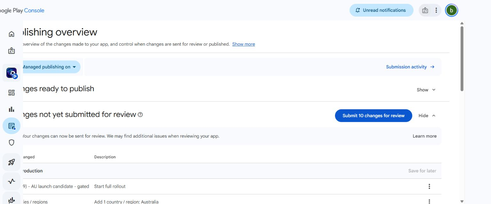

# Australian Google Play activation gate — 2 November 2026

> **Historical checkpoint, superseded on 6 November 2026.** Docked's ten Australian changes are now **in Google review**, with managed publishing ON and payments/public registration still OFF. The named migrations below were subsequently approved and applied; do not reapply them or request the same approval. The owner subsequently confirmed the player-name position, approved/published v2 policies and the narrow privacy v3 clarification. These are recorded owner decisions, not a newly inferred licence. Current deployment is `7319dddd`. Use the [actual submission and remaining activation report](qa/google-submission-20261106/FINAL_SUBMISSION_REPORT.txt), [current operations procedure](DUAL_STORE_OPERATIONS_20261105.md), and [separate commercial continuation](ops-launch-20261105/COMMERCIAL_OPERATIONS_CONTINUATION_20261106.txt). The text below preserves what was true at this original 2 November checkpoint and is not a current task/approval list.

**Release prepared; not submitted, approved, published or charging customers.** The owner has conditionally authorised submission and later payment activation. The remaining conditions are substantive technical/external requirements, not another commercial-model decision.

## Work completed in this continuation

- Saved the first **Production release draft**, `30 (1.29) - AU launch candidate - gated`, using the existing signed v30 bundle from Google's library. No native rebuild, duplicate upload or testing-track change. Saved release notes and verified the publishing overview now lists **10 changes not yet submitted**, including the release, Australia, store listing, age/content, privacy and Data Safety declarations. App-access and financial-feature responses remain recorded. Google's automated pre-submission checks permit sending the draft; they are not a legal/commercial or app-review approval.
- Switched **managed publishing on**, so a later approval does not itself authorise immediate publication. This first release offers full rollout only; percentage-based staging is for subsequent updates. No Submit/Publish/Activate action was taken.
- Re-read Google's current product catalogue: `docked_credits_4900_v1` / `buy-au`, **A$49 → 4,900 credits**; `docked_credits_9900_v1` / `buy-au`, **A$99 → 9,900 credits**. Both INACTIVE, AU region only, multi-quantity false. No bonus credits. The read-only refund endpoint and generated-v30 APK endpoint both returned HTTP 200. No receipt token or customer details are in evidence.
- Captured a consistent, read-only Production PostgreSQL snapshot and encrypted the custom-format dump before it touched disk. Restored it into an isolated PostgreSQL 17.11 container with **no network, no published ports, no Auth/API service, cron disabled and the pg_net worker pointed at an unused database**.
- Applied and reapplied the three exact pending migrations successfully against that restored Production data. The 17 recorded protected-table checksums matched the captured snapshot, and remained unchanged after both applications. These cover Auth users, feature flags, beta cards/ownership/sales, wallets/pack journals, competition entries/results and NFL/multisport round controls. The temporary database is stopped; its plaintext data was on tmpfs. Encrypted backup and private metadata remain ignored by Git.
- Independently streamed and authenticated the complete encrypted archive and matched its SHA-256 and length (**80,459,859 bytes**) without writing plaintext. No Production migration or customer mutation occurred.
- Improved the reusable Google read-only diagnostic to report regional prices, multi-quantity settings, caller-selected safe evidence path and nonzero status on failed provider checks. Added the reproducible read-only backup/isolated restore tool. Typecheck and targeted lint passed; existing application/billing/gameplay suites were not needlessly repeated.

## Exact release identities

| Surface | Actual state |
|---|---|
| Live website | https://docked.com.au — private beta, `053848ed67946fdd727a5c1d8547272d383c9470`, deployment `dpl_2bWUkY1sgtshkifqRRty89oPfuzQ` |
| Protected web candidate | https://docked-production-cegqqc17p-briant-s-projects.vercel.app — READY, source `8dcfd9f18960936145a605595a01119a92fa1c89`, deployment `dpl_2KUfz1Haq2B5DUNbPM54AyQFG6Rs`; not assigned to docked.com.au |
| Android | `docked.fantasy`, versionCode **30**, versionName **1.29**; existing internal release and newly saved unpublished Production draft |
| AAB | `artifacts/android/Docked-commercial-candidate.aab`, 9,214,095 bytes; SHA-256 `d3837d7191e0a6bbd64a572a9ac3288fd37b440eb36e67408648fb4b3c879e29` |
| Google signing certificate | `64:F8:4E:E6:33:3C:E0:FE:7A:E3:08:A3:81:B0:9B:BF:AA:C0:2A:E6:EA:5A:CD:47:68:91:9C:E0:BC:DD:28:F1` |

At 22:48:05 UTC on 1 November (2 November Sydney), actual live HTTP readback confirmed registration closed and the old live release identity. The new commercial and public-gameplay routes return **404 on live**, rather than the closed candidate's 403. Thus the public backend must not be reported as deployed or accepted. At 22:46:56 UTC, Production's commercial/public schemas and all three pending migration identifiers were absent. NBA, cash features, prizes and paid competition entry were not enabled by this work.

The Google draft preview had **no blocking error and two warnings**: missing deobfuscation file (current release is not minified) and missing native debug symbols. The latter reduces native-crash diagnosis quality; it is not reported as uploaded or fixed. No public Google review outcome exists.

## Migration package and recovery

| Migration | Isolated restored-Production application | Hosted application |
|---|---|---|
| `20261101120754_commercial_google_ledger.sql` | Applied twice, passed | Pending explicit approval |
| `20261102010000_commercial_lineup_inventory.sql` | Applied twice, passed | Pending explicit approval |
| `20261102010001_public_customer_gameplay.sql` | Applied twice, passed | Pending explicit approval |

The owner's latest instruction permits only previously reviewed **approved** migrations. Specific Production approval for these three was requested after the restore passed. No blanket pending migration push is authorised. Earlier approved TEST/roster migrations are not applied again.

See `COMMERCIAL_MIGRATION_APPROVAL_20261102.md` and `PUBLIC_CUSTOMER_ACTIVATION_REVIEW_20261102.md` for effects and rollback. All new sales, issuance, transfer, programme and sport switches remain off; permanent definitions are empty; no customer accounts, cards, balances, entries or prizes are created on migration. Existing private-beta engine behaviour and historical records remain intact.

The backup is a **logical database restore and migration compatibility test**, not a full hosted disaster-recovery claim. Custom role passwords, external secrets/configuration and Storage object bodies are not in it. Local roles were NOLOGIN; objects were restored with `--no-owner`, so managed object ownership must be mapped explicitly for an actual hosted recovery. Production function definitions and ACLs remain in the encrypted archive. Restore first required enabling the installed pg_cron/pg_net extensions safely and correcting a role-name filter that had mistakenly omitted `pgbouncer`; the final complete restore succeeded. Both failed attempts affected only the isolated target.

Rollback before any real receipt: keep feature gates off and restore the prior application alias. After a receipt exists: stop new checkout/issuance, keep refunds/support/reconciliation operational, retain ledgers and ownership/audit history. Never overwrite newer wallet transactions with an older snapshot. Any function-wrapper rollback is a separately reviewed transaction with saves/transfers quiesced, not a schema drop. Refresh the backup before a later application if intervening records changed.

## Mandatory gates still open

1. **Documented rights and external assessment.** No executed commercial player/card/data authority or current Docked-specific Australian legal/classification clearance was established from the available repository/evidence search. An older forwarded assessment is not a licence or current clearance. Existing document/adviser references were requested; no new provider subscription or unlicensed feed was enabled. Google approval and any applicable Payments permissions remain outstanding.
2. **Final policies and operations.** Approve and publish the prepared Privacy, Terms, Refund and retention versions with actual periods/bases, recovery-hold review/appeal process, staffing and financial settlement/tax process. The business model is approved; these unresolved facts cannot be fabricated. Draft locations remain `policies/2026-11-01-commercial-review/`.
3. **Production runtime and migrations.** Apply only the named approved migrations, provision the separately scoped commercial runtime/identity-binding/encryption keys, authenticated commercial notification subscription and durable worker. Existing Google TEST credentials/receipts are not silently converted into commercial acceptance. Receipt retention/minimisation must follow the approved policy.
4. **Licensed inventory and public competitions.** Reconcile existing lifetime supply/serial baselines before seeding commercial definitions. Bind verified eligible roster/fixtures and fresh free/no-prize NFL/AFL/NRL rounds with approved source/scoring policy. The completed ordinary-member isolated journey proves selection/save/entry/history; actual public postgame score projection and authorised real-data coverage remain unaccepted. Do not advertise this as functioning live public scoring.
5. **Exact hosted release acceptance.** Verify public-mode ordinary signup, email confirmation, free-Core gameplay, deletion/retention and commercial wallet/pack/refund/recovery on the exact protected configuration. Then verify the Play-installed v30 client. Genuine earlier 4,900/9,900 TEST purchases/refunds/RTDN and reviewer/account-deletion journeys remain valid in their documented scope; none proves a genuine commercial charge. No new physical-device or commercial-settlement pass is claimed.
6. **Accurate final Console.** Replace the three stale beta listing screenshots with actual accepted public-scope screens, reconcile existing Data Safety/App access/financial/privacy/deletion answers and resulting IARC rating with the final configuration, and obtain any required owner-only legal attestation. Reviewer login remains owner-entered in Console; normal security is preserved. After all gates pass, submit under the already granted conditional authority. After Google approval, verify deployed gates before authorised publication/payment activation.

Commercial transfers/coupons/card sharing are deliberately off for the prepared commercial scope; existing private-beta functionality is preserved. Turning on paid packs does not silently enable them. Withdrawals, paid entry, cash prizes and NBA remain excluded.

## Current sources checked

- [Google Payments policy](https://support.google.com/googleplay/android-developer/answer/9858738): digital-content billing, accurate prices and random-item odds near purchase. Policy access does not approve Docked.
- [Google gambling/games/contests policy](https://support.google.com/googleplay/android-developer/answer/9877032): real-world-value and DFS restrictions must be assessed against the actual linked product. Random packs alone are not declared gambling here.
- [Staged rollout limits](https://support.google.com/googleplay/android-developer/answer/6346149): not available for a first publication; the saved first-release overview says full rollout. Managed publishing is enabled to preserve a deliberate publication step.
- [Australian Classification guidance](https://www.classification.gov.au/about-us/media-and-news/news/new-classifications-for-gambling-content-video-games): chance-based purchases require accurate classification; an 18+ target audience is not itself a rating or legal clearance.
- [ACCC consumer remedies](https://www.accc.gov.au/consumers/problem-with-a-product-or-service-you-bought): mandatory remedies are not displaced by a spent-credit recovery mechanism. The prepared disclosure preserves statutory rights.
- [Supabase backup scope](https://supabase.com/docs/guides/platform/backups): database backups do not restore Storage object bodies or custom role passwords.

## Evidence and status

`qa/public-activation-20261102/`: `console-state.json`, `google-readiness.json`, `production-http.json`, `production-database.json`, `restore-drill.json`, `archive-integrity.json` and Console screenshots. Prior actual implementation tests and isolated rendered journeys are recorded in `PUBLIC_CUSTOMER_RELEASE_HANDOVER_20261102.md`; their scope is unchanged.

**SUBMITTED: no. APPROVED: no. PUBLISHED: no. PAYMENTS ACTIVE: no.** The actionable Google draft is saved, encrypted restore/migration compatibility is verified, and the live customer data is untouched. Owner action needed now: respond to the precise migration request and provide the existing rights/legal/policy evidence or commission the missing external review. No repeated approval of the pack business model or routine submission authority is needed.

