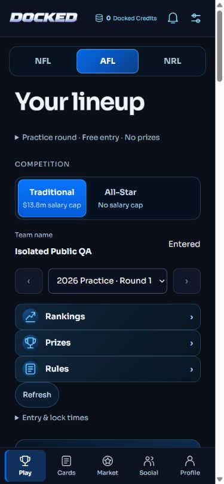
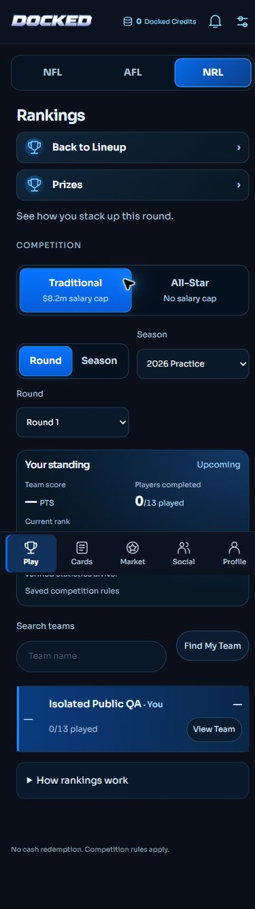
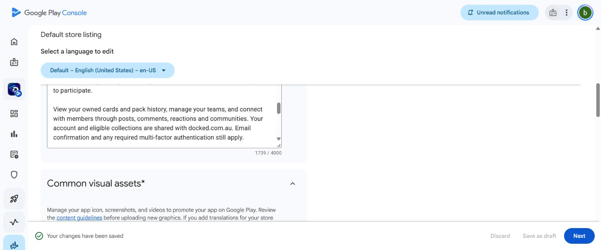

# Commercial approval and public customer readiness — 2 November 2026

Subsequent release preparation and authority: see `PUBLIC_ACTIVATION_GATE_20261102.md`. It records the successful Production logical restore, migration reapplication checks and unpublished Google v30 Production draft. The dated acceptance below is preserved; conditional submission authority is now granted, without a new business-model approval.

**The owner commercial model is approved. Live customer charging and public submission are not ready for activation.** The remaining gates concern rights, regulatory/platform verification, published policies, migration/runtime provisioning and exact hosted release acceptance. No repeated approval of pack prices, odds, multipliers, credits, fees or the disclosed recovery-hold design is requested.

Read the preserved commercial architecture/test report in `COMMERCIAL_GOOGLE_RELEASE_HANDOVER_20261102.md` alongside this update. This update closes its ordinary-member route integration gap with actual isolated Auth/browser acceptance; it does not claim public Production or real-money acceptance.

## Implemented since the previous checkpoint

- A default-disabled public-member programme reuses the existing NFL/AFL/NRL lineup engine and shared Play, Rankings and Prizes components. No beta allowlist or wallet grant is needed. Only new, explicitly bound free/no-prize rounds qualify. Saved rules and existing historical entries remain unchanged.
- Registration checks the current evidenced Australian adult policy and consent versions before creating an Auth user. Normal email confirmation, active sessions and staff MFA remain enforced. Public signup/onboarding exposes NFL/AFL/NRL, not NBA or unsupported sports.
- Public free Core remains projected gameplay eligibility, not collectible issuance. Salary/position/uniqueness/ownership/locking validation stays in the existing authoritative engine. Saved rarity multipliers are displayed without multiplying imported points again.
- Public Profile no longer calls the private-beta gameplay reader. It uses a narrow authenticated permanent-team-name read and the existing complete collection/entry/pack summary API. Failed reads remain errors, not fabricated zeros.
- Wallet/collection reading no longer eagerly initialises Google OAuth. A verifier credential outage cannot unnecessarily hide a member's records; receipt verification still fails closed before accepting a purchase.
- Public no-prize pages suppress the unrelated upcoming cash-prize preview. Commercial trading is explicitly unavailable in the prepared release rather than displaying a private-beta loader failure. Existing beta marketplace functionality is unchanged.
- The web offline shell has account-neutral copy, confirms no purchase, and never caches private account pages. It does not modify the signed Android binary.
- The Google Play full store description was saved **as a draft** with the intended paid-pack/free-Core/no-cash scope. No public submission or legal attestation was made. Existing listing screenshots still need replacement/verification against the final activated scope.

## Actual new acceptance

All mutations used disposable loopback Supabase Auth/PostgreSQL, synthetic players and local email capture. No Production account, balance, card, entry, Google order or support email was mutated.

1. Registered an ordinary synthetic account through the actual signup form with Australian state, adult attestation and current consent. Opened its captured verification email and completed normal onboarding. No admin confirmation, beta admission or security bypass.
2. Set a permanent team name, reviewed Auto Select, saved and confirmed a free Traditional entry in each sport: NFL **7**, AFL **22**, NRL **13** players. NFL used $3.5m/$4.4m, AFL $11m/$13.8m, NRL $6.5m/$8.2m. Confirmed the NRL any-position Flex and AFL 6/8/6/2 grouping.
3. Viewed saved entries in Rankings; NFL View Team and mobile NRL standing matched the saved lineup. Upcoming scores stayed blank/not ranked, with zero completed players. No statistics or results were invented.
4. Returned to the selected Traditional competition and saw the preserved entry. Collection remained **0 owned cards**, wallet **0 credits**, pack history **0**, Profile **1 entry** for the selected sport. Direct database readback independently confirmed one entry per sport, zero collectible cards, receipts, packs and credits.
5. Verified all six NRL pack variants/prices, disabled purchase buttons, sport-aware wallet/collection/history links, no native checkout control while disabled, and normal Social feed access. Commercial transfer UI stays closed. No new purchase was attempted.
6. Inspected desktop and 390-pixel browser layouts, including mobile Profile, AFL Play, NRL Rankings, no-prize presentation and packs. Browser session survived the local server restart and normal web-app update. This is not physical-device or hosted acceptance.

The first local Profile load failed because it depended on `fantasyRequest()` and beta admission. That root cause was corrected and the rendered route/counters retested. Development Strict Mode also closed the existing Auto Select review; the optimized release build was used for accepted mutation journeys. A browser attachment timeout during restart was recovered with a fresh tab; it is not reported as an app test pass.

## Checks

| Check | Result |
|---|---|
| Platform regression | 710 passed, 0 failed/skipped, after the substantive changes. NFL/AFL/NRL and hidden-NBA guards included. |
| Full database regression | 233 passed, 0 failed/skipped. The later narrow Profile-name read was covered by all three targeted public-member tests and real PostgreSQL runs. |
| Public-member database tests | NFL/AFL/NRL: 3 passed; wrong sport/round, no beta access, consent/age/session/MFA denial, restricted role, idempotent entry and migration reapplication. |
| Real PostgreSQL | Separate disposable 17.10 NFL, AFL and NRL runs passed. Production was read-only and reports 17.11. |
| TypeScript / ESLint / build | Passed. Optimized production build includes five commercial server-secret canaries; all absent from 96 browser assets. Final tiny duplicate-selector cleanup also receives TypeScript/lint and candidate build verification. |
| Data integrity | Isolated readback: 3 entries / 42 selected slots; zero collectible cards, receipts, purchased packs or credits. No Production mutations. |
| Previously accepted billing | Genuine Google TEST 4,900/9,900 credit, member wallet, nine-card issuance, refund and authenticated notification/reconciliation evidence retained. Not repeated or relabelled commercial settlement. Prior commercial fixture concurrency/refund/closure tests retained. |

Evidence is in `qa/public-customer-20261102/`, including logs, readback and screenshots. The prior account-deletion and reviewer journeys remain valid within their documented isolated/beta scope; no genuine account was deleted and no password is stored here.

## Google products and customer flow

| Google consumable | AU price | Wallet credits |
|---|---:|---:|
| `docked_credits_4900_v1` / `buy-au` | A$49 | 4,900 |
| `docked_credits_9900_v1` / `buy-au` | A$99 | 9,900 |

No bonus credits or new direct-pack Google SKU. Both Google options remain inactive at the last verified readback. Standard 1/3/9 costs 100/300/700 credits; Premium 1/3/9 costs 700/1,900/5,000 credits. Existing odds and supply rules are unchanged.

The intended enabled flow is: sign in → native Google credit purchase with server-bound member identity → server purchase/order verification → one atomic wallet credit and durable consumption job → separately confirm a pack → atomic draw/charge → idempotent opening/serial ownership → shared collection/history. Pending/cancelled receipts do not credit. Commercial runtime rejects TEST purchases and cross-account/token replays.

Verified full refunds reverse unused purchase funding. Spent funding creates an auditable recovery hold, not a negative spendable balance, automatic debt or confiscation of another member's cards. Partial refunds and inconsistent provider records go to support review. Durable authenticated notifications and scheduled receipt rechecks recover after outages. The existing TEST notification proof is not proof that the separately gated commercial endpoint/worker has been provisioned in Production.

## Migrations, Android and activation

Production read-only check at 2026-11-01 21:55:48 UTC: registration false, commercial/public schemas absent, all three pending migrations absent. No migration was applied to Production:

1. `20261101120754_commercial_google_ledger.sql`.
2. `20261102010000_commercial_lineup_inventory.sql`.
3. `20261102010001_public_customer_gameplay.sql` — new disabled public programme, strict eligibility and immutable future-round bindings; no wallet/card/entry/fixture creation on application.

The application/backup/restore/rollback runbooks are `COMMERCIAL_MIGRATION_APPROVAL_20261102.md` and `PUBLIC_CUSTOMER_ACTIVATION_REVIEW_20261102.md`. A fresh approved encrypted Production backup and successful isolated restore remain pre-apply requirements. Apply only named migrations; never a blanket pending push. Do not drop financial/audit records or restore old wallet balances as rollback.

Android remains **versionCode 30 / versionName 1.29**, package `docked.fantasy`, already available to internal testers. `artifacts/android/Docked-commercial-candidate.aab` remains 9,214,095 bytes, SHA-256 `d3837d7191e0a6bbd64a572a9ac3288fd37b440eb36e67408648fb4b3c879e29`. No unnecessary native rebuild. No fresh physical v30 purchase acceptance or real-money settlement is claimed.

## Exact remaining release gates

1. **Rights and external assessment:** documented player/card/roster/statistics rights by sport; reconciled lifetime supply baselines; Australian classification and legal assessment of the linked pack/fantasy/transfer model; applicable Google eligibility. Existing access to data and owner approval do not establish these rights.
2. **Publishable policies/operations:** final Terms, Privacy, Refund and commercial wording; explicit retention periods/bases, archival/minimisation and support/appeal staffing; financial settlement/tax reporting. Drafts are in `policies/2026-11-01-commercial-review/`. No indefinite-retention or legal-review claim.
3. **Approved deployment:** the three exact migrations, backup/restore evidence, restricted commercial runtime/keys, notification subscription/worker and immutable consent/regional configuration. Commercial TEST infrastructure must not be silently repurposed as the commercial production verifier.
4. **Public programme:** bind approved roster/fixtures and new free/no-prize rounds, with their authoritative scoring/source policy; verify actual postgame score projection before advertising scored public competitions. Local acceptance proves signup/selection/entry/history, not licensed source coverage or public live scoring. Preserve historical rounds and hidden NBA.
5. **Final acceptance:** exact protected hosted public-mode signup, confirmation, free-Core journey, deletion/retention and commercial receipt/pack/refund/recovery configuration, followed by Play-installed v30 device acceptance. Earlier TEST receipts alone do not prove this new deployment.
6. **Console and activation:** replace stale beta listing screenshots, reconcile Data Safety/App access/privacy/deletion/financial declarations with the final configured behaviour, obtain required owner attestations, and then the final public submission/product/registration activation decision. Reviewer credentials remain owner-entered in Console; the existing practice programme expires 2027-01-31 UTC.

NBA, real charges, registration, withdrawals, paid entry and prizes remain off. Commercial coupons, card sharing and transfers are not advertised as active for commercial inventory. The existing beta experience and records remain intact.

## Release evidence

Code commits `ac29f1db` and `8dcfd9f1` are pushed. The protected candidate is READY at https://docked-production-cegqqc17p-briant-s-projects.vercel.app, deployment `dpl_2KUfz1Haq2B5DUNbPM54AyQFG6Rs`, source `8dcfd9f18960936145a605595a01119a92fa1c89`.

Hosted checks passed: 19 release/route/access checks and seven commercial/public-gameplay guards, all seven returning 403 with `private, no-store`. This verifies closed access, not an authenticated customer purchase. Public-mode journeys above ran in the isolated local environment only.

At 2026-11-01 22:27:09 UTC, `docked.com.au` still resolves to `dpl_2bWUkY1sgtshkifqRRty89oPfuzQ`, source `053848ed67946fdd727a5c1d8547272d383c9470`. No live-domain promotion, Production migration, customer mutation, charge or public submission occurred. Full sanitized deployment identities and checks are in `qa/public-customer-20261102/release.json` and `qa/public-customer-20261102/candidate/candidate-http.json`.

